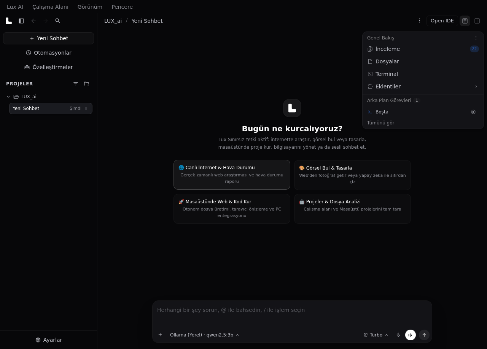
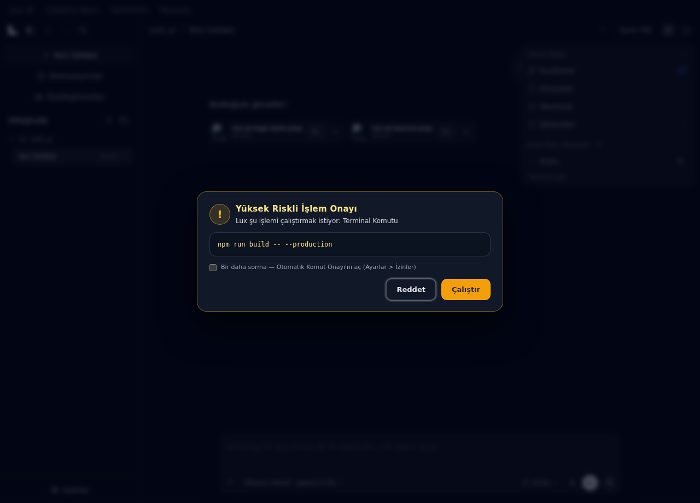
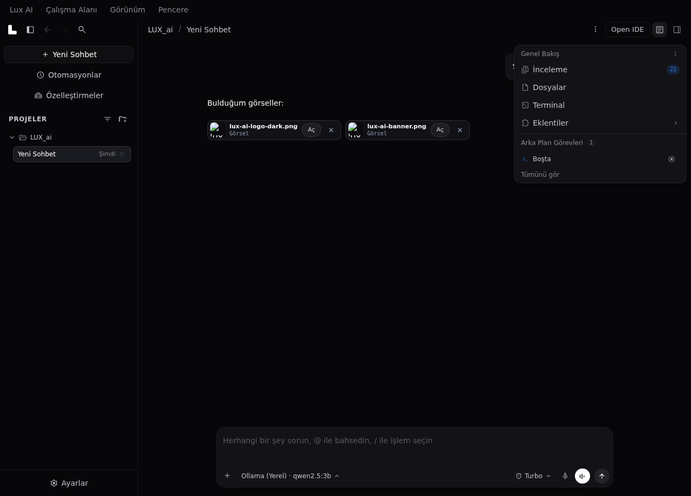
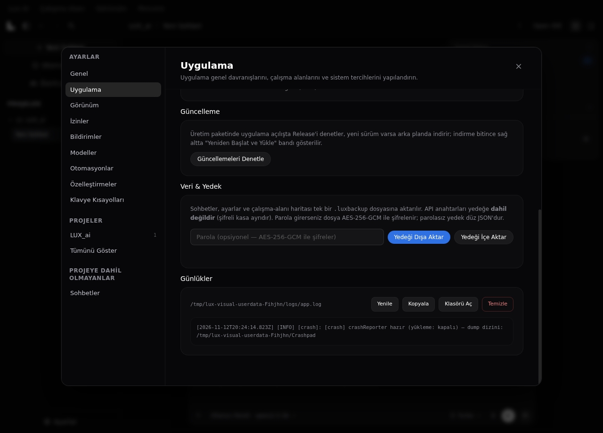

# Lux AI — Agentic Desktop Application (English overview)

> Türkçe belgeler için: [README.md](README.md). Katkı: [CONTRIBUTING.md](CONTRIBUTING.md). Güvenlik bildirimi: [SECURITY.md](SECURITY.md). Yayın süreci: [RELEASING.md](RELEASING.md).

Lux AI is an agentic desktop assistant (Electron) that can actually act on your machine — not just chat. It searches the live web, finds and generates images, creates and edits files/projects, runs terminal commands and controls the PC — always behind explicit, visible permission gates. Turkish-first UI and agent, with an i18n skeleton (EN keys included).

## Screenshots

|                                                                              |                                                                                            |
| ---------------------------------------------------------------------------- | ------------------------------------------------------------------------------------------ |
|                                     |                                    |
| **Landing** — dark theme, sidebar, suggestion cards                          | **High-risk action approval** — `run_command` / `delete_path` never run without your click |
|                              |                                 |
| **Agent images as compact chips** — click: lightbox, ×: removes from message | **Settings > Application** — Data & Backup (.luxbackup) and live log viewer                |
|                                                                              |                                                                                            |

## Highlights

- **Agent with real tools**: web search/fetch, image search & AI generation, file/folder CRUD on Desktop & workspace, PowerShell terminal, screen capture, PC control — each tool's permission is toggled in Settings → Permissions.
- **High-risk actions need your click**: `run_command`, `delete_path` and non-read-only `pc_control` show an in-app approval dialog while `auto_approve_commands` is off (default).
- **Voice-first**: dictation, voice mode, TTS with local engines (Piper, Kokoro), offline Whisper STT — models download only with your consent (~244 MB once).
- **Key vault**: API keys are stored encrypted (Electron safeStorage or AES-256-GCM fallback), never in localStorage/plaintext; vault schema v2 with rotation.
- **Model freedom**: Google Gemini, OpenAI-compatible (incl. local LM Studio / Ollama / 9Router), Anthropic, OpenRouter — with automatic fallback to a local model when cloud is unreachable (never in voice turns, never on 401/403/429).
- **Hardened**: SSRF guard for agent network access, PowerShell injection sanitization, IPC parity tests, encrypted vault, single-instance lock, fs-destructive-target shield, zero npm audit vulnerabilities, strict Content-Security-Policy (`script-src 'self'`) with all inline handlers moved to delegated click actions, app-sender guard on the terminal IPC, crash/rejection logging in the main process.

## What's new in v1.5.0

- **In-app auto-update**: `electron-updater` checks the GitHub Releases feed at startup (production builds only) and shows a small update banner; manual check via Settings → Application → Update; `release.yml` now attaches `latest*.yml` updater manifests to the release.
- **Plugin sandbox**: plugin HTML renders inside `sandbox="allow-scripts"` (no `allow-same-origin`) — cannot reach the host window or `luxAPI`.
- **Data & Backup**: chats/settings/workspace map export to a `.luxbackup` file (optional password → AES-256-GCM); API keys are never included; import writes an automatic `.bak` first.
- **Live log viewer**: Settings → Application → Logs — last 64 KB, copy/open folder/clear.
- **Visual regression gate**: `npm run test:visual` (5 baseline captures, pixelmatch-vs-baseline).
- **i18n key coverage test**, screenshots in README, `chat.js` modularization started (`agent_workspace.js`).

## What's new in v1.4.1

- **Content-Security-Policy** embedded in the page (`script-src 'self'`, `object-src 'none'`, `base-uri 'none'`, `form-action 'none'`; images/frames allowed for agent web results + Aux Browser).
- **All inline `onclick` handlers removed** (39 sites) → `data-action` attributes + a single delegated click listener (`src/js/delegated_actions.js`); chat-internal dynamic actions stay in `chat.js`.
- **Terminal IPC sender guard** — only the app window's own webContents may invoke `terminal-execute`.
- **Uncaught exceptions / unhandled rejections are logged** in the main process (no more silent death paths).
- **CI/release**: Python guaranteed via `setup-python@v5`; release artifacts now include `latest*.yml` updater manifests; artifact retention 14 days.

No product/UX changes vs v1.4.0 — this is the security follow-through release.

## What's new in v1.4.0

- **`npm run verify`** — one-command quality gate: tests (46/46), ESLint, Prettier, CSS drift check, boot smoke test and the real IPC e2e cycle (xvfb) all green.
- **Internal browser coordinate picker** — drop markers on any page inside the Aux Browser; the agent receives pixel coordinates as hidden `[KONUM REFERANSLARI]` context (chip-only UI, no raw text leakage).
- **Compact media chips** — agent-found/generated/screenshot images render as compact thumbnail chips in chat (click to lightbox, × removes them from the message, persisted).
- **Key vault v2** — schema-versioned vault with `secrets-rotate` tooling; keys from v1 migrate automatically (reported version 2026-11-12 applies).
- **Feedback button removed** — broken `mailto:` path for "Send feedback" was removed from the UI.
- **i18n expansion** — voice consent and approval dialogs are on the i18n skeleton; full coverage is still in progress.
- **Release automation** — tag push builds Windows NSIS + Linux AppImage and attaches them (with `latest*.yml` updater manifests) to a GitHub Release via `.github/workflows/release.yml`.

## Requirements

- Windows 10/11 (primary target) or Linux; Node.js **≥ 22.12** (CI and Electron 45's embedded Node align on 22), Python 3.12 for the voice service.
- `npm ci` → Monaco vendored automatically (`postinstall`) → `npm start`.

## Development quickstart

```bash
npm install
npm run vendor:monaco   # if needed
npm run css:build       # src/css/tailwind.input.css -> compiled_tailwind.css (commit both)
npm start
```

### Verification (all local, no network needed)

```bash
npm test                # 21 architecture + 6 model-client + 10 IPC-validator + 9 context-rollup (46/46)
npm run test:e2e        # real boot cycle (auto xvfb on Linux): IPC, vault, terminal, git, fs, voice, UI probes
npm run test:smoke      # boot + console errors
npm run lint            # ESLint (sharp, bug-focused rule set)
npm run verify          # ALL of the above in one gate — must stay green before any release
```

## Architecture (map)

- `main.js` — window, permissions, terminal, voice subprocess, state bridge; IPC cores live in `src/main/*.js` (`secrets_vault`, `agent_ipc`, `git_ipc`, `plugins_ipc`, `edit_snapshots`).
- `src/preload.js` — `contextBridge` surface (`luxAPI.*`), minimal and typed.
- `src/js/*` — renderer: `chat.js` (orchestration), `model_client.js`, `model_output_parse.js`, `agent_context.js` (system prompt), `tool_schemas.js`, `store.js` (state), `voice.js`, `tool_approval.js`, `i18n.js`, … Loaded as classic scripts in `index.html` order (tests enforce the order).
- `scripts/agent/*.js` — main-process agent capabilities (web, images, pc, files, paths) + `net_guard.js` (SSRF/PowerShell hardening).
- `scripts/voice_service.py` — stdio-JSON Python service for STT/TTS.

## Testing philosophy

Every fix ships with a failing-first test where practical; tests run on real files, not mocks of our own code. Network-adjacent layers are tested with stubbed `fetch` (see `scripts/test_model_client.js`). E2E uses an isolated `userData` profile — your real data is never touched.

## License

ISC — see [LICENSE](LICENSE).
